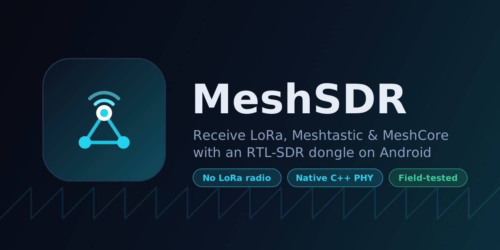
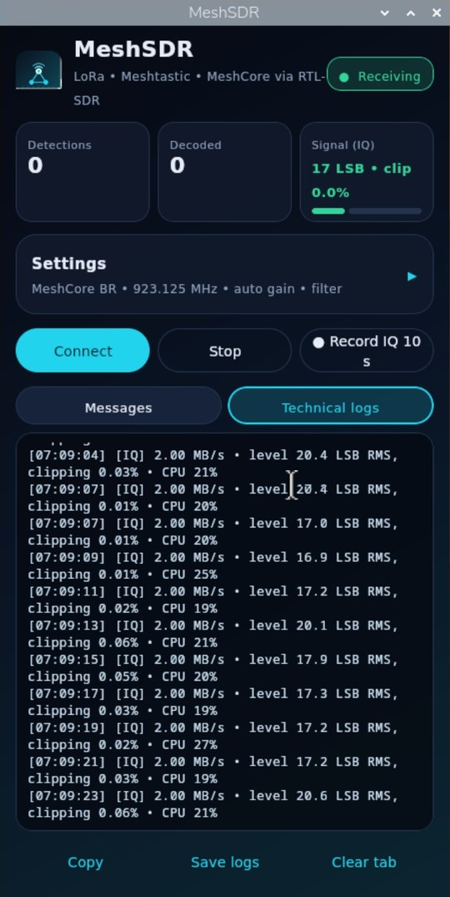
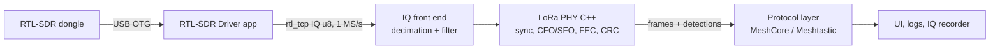
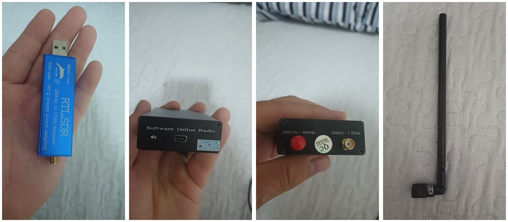

<p align="center">
  
</p>

<p align="center">
  <a href="https://github.com/engperini/MeshSDR-Android/releases/latest"></a>
  <a href="https://github.com/engperini/MeshSDR-Android/actions/workflows/quality.yml"></a>
  <a href="https://github.com/engperini/MeshSDR-Android/actions/workflows/android.yml"></a>
  <a href="LICENSE"></a>
  
</p>

**MeshSDR turns an Android phone and a ~US$30 RTL-SDR dongle into a passive LoRa receiver.**
It demodulates LoRa in real time on the phone, with a native C++ PHY, and shows what
**Meshtastic** and **MeshCore** mesh networks around you are transmitting. You don't need a
LoRa radio, a PC or GNU Radio.

<p align="center"><br>
<sub>The desktop app on a Raspberry Pi 4B, listening on the MeshCore BR channel at about 20% CPU.</sub></p>

## Features

- **Real-time LoRa demodulation on the phone.** Preamble and sync detection, CFO, STO and
  SFO compensation, deinterleaving, Hamming FEC and CRC, from the RTL-SDR's raw IQ stream.
  SF7–SF12, BW 15.6–500 kHz, CR 4/5–4/8, explicit header.
- **Sees traffic it can't fully decode.** A valid LoRa header is reported as a *detection*,
  with length, SNR and sync word, even when the payload is too weak to pass CRC.
- **MeshCore interpretation.** Route type, payload type, hop count, the repeaters in the
  path, and sizes of encrypted payloads. ADVERT packets show the **node type, name and GPS
  position**, since they are signed but not encrypted.
- **Meshtastic interpretation.** The radio header: sender, destination, packet id, channel
  (the public LongFast channel is recognised), hops taken, relay node and ACK request.
- **Any sync word.** It reports `0x2B` (Meshtastic), `0x12` (private / MeshCore) and
  `0x34` (LoRaWAN), and flags a sync word that doesn't match the selected profile.
- **Ready-made profiles.** Meshtastic BR (ANZ LongFast, 919.875 MHz) and MeshCore BR
  (923.125 MHz, SF8 / BW 62.5 kHz) for Brazil, plus Meshtastic US (906.875 MHz). The
  frequency can be edited.
- **Generic LoRa mode.** Listen on any frequency for any LoRa transmission: pick one SF or
  run **SF7–12 at once**, type the bandwidth (default 125 kHz, the common LoRa IoT setting), and see the frames as raw bytes, without
  assuming Meshtastic or MeshCore.
- **Field station: Raspberry Pi + phone, no internet.** MeshSDR runs headless on a Raspberry Pi
  and decodes; the phone app is its screen over **Bluetooth or Wi-Fi**, with the same interface,
  settings, messages and logs, and can download its recordings.
- **English and Portuguese.** Follows the phone's language, switchable in the app.
- **Radio controls.** Tuner gain (AGC or 20–49.6 dB), a live IQ level and clipping meter,
  an optional decimation filter, and **ppm correction** for dongles without TCXO. Every
  detection shows the measured carrier offset and the ppm value to set.
- **Keeps listening with the screen off.** A foreground service and wake lock keep it
  running for long monitoring sessions.
- **Records raw IQ.** 10-second `.cu8` captures and log exports go to `Download/MeshSDR`,
  for analysis in tools like GNU Radio, inspectrum or SDR++. Optional **automatic
  recording** saves the 3 s before and the seconds after every LoRa detection, so each
  packet is kept from its preamble on.

## What you need

| Item | Notes |
| --- | --- |
| Android 8.0+ phone with USB OTG | Field-tested on a recent Android phone |
| RTL-SDR dongle (RTL2832U) | Tested with R820T/R820T2 tuners |
| OTG adapter + an antenna tuned for 900 MHz | Mount it outside or near a window; a car body costs 10–20 dB |
| [RTL-SDR Driver](https://play.google.com/store/apps/details?id=marto.rtl_tcp_andro) (`marto.rtl_tcp_andro`) | Free app that opens the USB dongle and serves IQ over a local `rtl_tcp` socket |

## Quick start

1. Install **RTL-SDR Driver** from Google Play.
2. Download `MeshSDR-<version>.apk` from the
   [latest release](https://github.com/engperini/MeshSDR-Android/releases/latest) and install it.
3. Plug in the dongle, open MeshSDR, pick a profile (for example **MeshCore BR**) and tap
   **Connect**.
4. Leave it listening. Detections and decoded packets appear in **Messages**, and radio
   details in **Technical logs**.


## Desktop app (Windows / Linux / Raspberry Pi)

The same receiver as a desktop app, with the phone's interface: a Kotlin + Compose
Multiplatform window over the same C++ LoRa PHY and the same protocol code.

- **Windows:** plug in the dongle and install the WinUSB driver once with
  [Zadig](https://zadig.akeo.ie/) (as for any RTL-SDR program). Then install the `.msi`, or
  unzip the portable build. `rtl_tcp` from the RTL-SDR Blog drivers is bundled.
- **Linux:** `sudo apt install rtl-sdr` (provides `rtl_tcp`), then install the `.deb` or
  unpack the portable build and run `MeshSDR/bin/MeshSDR`. If the dongle is busy, unload the
  DVB-T driver: `sudo rmmod dvb_usb_rtl28xxu`.
- **Raspberry Pi 4/5:** same as Linux, with the `arm64` `.deb` or the `linux-arm64` portable
  build. It needs the 64-bit Raspberry Pi OS (`uname -m` prints `aarch64`).
- **Remote dongle:** turn off "start rtl_tcp" and type the address of any `rtl_tcp` server, e.g. a
  Raspberry Pi on the roof running `rtl_tcp -a 0.0.0.0`.
- `--connect` starts receiving at launch, for unattended monitoring stations.

Tested on **Linux Mint** (x64), **Raspberry Pi 4B** (64-bit Raspberry Pi OS, about 20% CPU
on the MeshCore channel) and **Windows** on a recent Intel Core i7.

Download the `.msi`, `.deb` or portable builds from the
[latest release](https://github.com/engperini/MeshSDR-Android/releases/latest).

## Field station: Raspberry Pi + phone (no internet)

The Pi keeps the dongle and antenna and **decodes**; the phone only shows the results and sends
the settings. Only decoded packets and logs travel between them (a few KB), over **Bluetooth**
or the Pi's own **Wi-Fi hotspot**. If the link drops, the Pi keeps decoding and the phone gets
the history when it reconnects.

**1. Install on the Pi** (64-bit Raspberry Pi OS):
```bash
sudo apt install rtl-sdr python3-dbus python3-gi ./meshsdr_<version>-1_arm64.deb
echo 'blacklist dvb_usb_rtl28xxu' | sudo tee /etc/modprobe.d/blacklist-rtl.conf
```

**2. Start MeshSDR at boot, without a window:**
```bash
sudo cp /opt/meshsdr/lib/app/resources/meshsdr-*.service /etc/systemd/system/
sudo systemctl daemon-reload
sudo systemctl enable --now meshsdr-server@$USER meshsdr-bluetooth
journalctl -u meshsdr-server@$USER -f     # watch it receive
```
It starts receiving with the last settings and reconnects if the dongle is unplugged. To use the
MeshSDR window on the Pi instead, stop the service first: `sudo systemctl stop meshsdr-server@$USER`.

**3a. Bluetooth: pair the phone once.** On the Pi's desktop use the Bluetooth icon → *Make
discoverable*, then pair from the phone's Bluetooth settings and accept on both. Without a desktop:
```bash
sudo bluetoothctl
# inside bluetoothctl:
power on
agent on
default-agent
discoverable on
pairable on
# now pair from the phone; answer "yes" here, then:
trust <phone address shown above>
quit
```

**3b. Or Wi-Fi: the Pi makes its own network** (run it on the Pi itself, not over SSH by Wi-Fi):
```bash
sudo nmcli device wifi hotspot ifname wlan0 ssid MeshSDR password <8+ characters>
sudo nmcli connection modify Hotspot connection.autoconnect yes
```
The Pi is `10.42.0.1` on that network.

**4. On the phone:** Settings → **Receiver: Remote (Pi / PC)** → **Bluetooth** (choose the Pi) or
**Wi-Fi** (`10.42.0.1`) → **Connect**. Every setting now changes the Pi's receiver; **Stop** only
disconnects the phone (the Pi keeps listening); **Recordings** downloads the Pi's `.cu8` files and
logs to `Download/MeshSDR`, slowly over Bluetooth (about a minute per 6 MB).

The Windows/Linux window has the same server: **Settings → Remote screen** lets the phone show a
computer's receiver over Wi-Fi (port 14424). Anyone who can reach that port can control the
receiver and download its recordings, so use it on the Pi's hotspot (WPA2) or a network you trust.

## How it works



- `app/src/main/cpp/`: the native LoRa PHY (`lora_lite`, derived from gr-lora_sdr), the IQ
  front end and the JNI bridge.
- `app/src/main/java/`: the Android app, the `rtl_tcp` protocol and the MeshCore/Meshtastic
  parsers.
- `app/src/test/cpp/`: an independent reference LoRa **modulator** and the PHY test suite.

## Tested, not just compiled

Every commit runs the PHY suite in CI:

- **Exact bytes** across 96 SF / CR / BW combinations, generated by an independently written
  LoRa modulator.
- The app's real input path: unsigned 8-bit IQ at 1 MS/s, split into random TCP read sizes
  (including 1-byte reads).
- Crystal error from −30 to +30 ppm, SNR down to −10 dB, 255-byte payloads, back-to-back frames.
- No false detections over 5 s of noise.
- **A real over-the-air MeshCore packet** recorded by the app in Jundiaí, Brazil.
  [`app/src/test/cpp/data`](app/src/test/cpp/data) holds the capture, and the decoder must
  recover its 70 bytes exactly. The capture is also attached to each release, so you can try
  it yourself.

### Field-tested hardware



| | Hardware | Result |
| --- | --- | --- |
| **A** | Blue aluminium RTL-SDR stick, R820T2 tuner, 1 ppm TCXO | Cleanest signal: 0.06% clipping on auto gain, 41 dB image rejection |
| **B** | Black aluminium box "Software Define Radio", HF + 25 MHz–1.7 GHz inputs, mini-USB | ~1.3% clipping on auto gain (triggers the app's saturation warning), extra internal spurs |
| | SMA whip antenna | Used with both dongles |

Both dongles were recorded on the same MeshCore channel (923.125 MHz). A synthetic MeshCore
frame (SF8 / BW 62.5 kHz) injected into each recording at decreasing levels decoded **at the
same threshold on both**: every time down to −18 dB below the background, half the time at
−21 dB. Dongle B's mild clipping did not cost decoding sensitivity. Dongle A did receive an
external carrier about 12 dB stronger, so it is the better choice for range.

## Roadmap

- **Desktop:** macOS, and MQTT output for monitoring stations.
- **In the browser:** WebUSB + WebAssembly, so you just plug the dongle into Chrome with no install.
- **Meshtastic:** protobuf decoding and decryption of public channels with their published
  default key.
- **MeshCore:** decryption of the public group channel; a map of nodes learned from ADVERTs.
- **Scanning:** several profiles and channels at once.
- Signed releases and a Play Store / F-Droid build.

Ideas and pull requests are welcome. Please open an issue first for larger changes.

## Build from source

Requirements: JDK 17, Android SDK 35, NDK 27.2.12479018, Gradle 8.11.

```bash
gradle :app:assembleDebug          # APK in app/build/outputs/apk/debug/
gradle :app:testDebugUnitTest      # Kotlin unit tests

# Native LoRa PHY tests on the host (Linux/macOS)
cmake -S app/src/test/cpp -B build-host -DCMAKE_BUILD_TYPE=Release
cmake --build build-host && ctest --test-dir build-host --output-on-failure
```

Desktop app (JDK 17+, CMake, Gradle 8.11+):

```bash
cmake -S desktop/native -B build-native -DCMAKE_BUILD_TYPE=Release && cmake --build build-native
mkdir -p desktop/resources/linux-x64 && cp build-native/libmeshsdr_lora.so desktop/resources/linux-x64/
cd desktop && gradle run                 # or: gradle packageDeb / packageMsi
```

APKs are signed with a **public test key** that is committed to the repo
(`app/meshsdr-debug.jks`), so every build can update an existing install in place. This key
is not a release-signing identity.

## Legal and responsible use

MeshSDR only **receives**; it never transmits. It does not break encryption: encrypted
payloads are shown only as sizes and hashes. Follow your country's rules about receiving
radio signals and about privacy.

## Credits and license

- The LoRa PHY core is derived from [gr-lora_sdr](https://github.com/tapparelj/gr-lora_sdr)
  (EPFL TCL) via
  [mmmaly/LoraReceiverStandalone](https://github.com/mmmaly/LoraReceiverStandalone). Local
  changes are listed in [`upstream/README-LICENSE.md`](app/src/main/cpp/upstream/README-LICENSE.md).
- USB access is provided by [RTL-SDR Driver](https://github.com/martinmarinov/rtl_tcp_andro-)
  by Martin Marinov.
- Protocol layouts follow the [MeshCore docs](https://docs.meshcore.io/packet_format/) and
  the [Meshtastic docs](https://meshtastic.org/docs/overview/mesh-algo/).

MeshSDR is free software under the **GNU General Public License v3.0** (see [LICENSE](LICENSE)).
Engineering notes and field-test records, in Portuguese, are in
[`docs/`](docs/engineering-notes.pt-BR.md).
